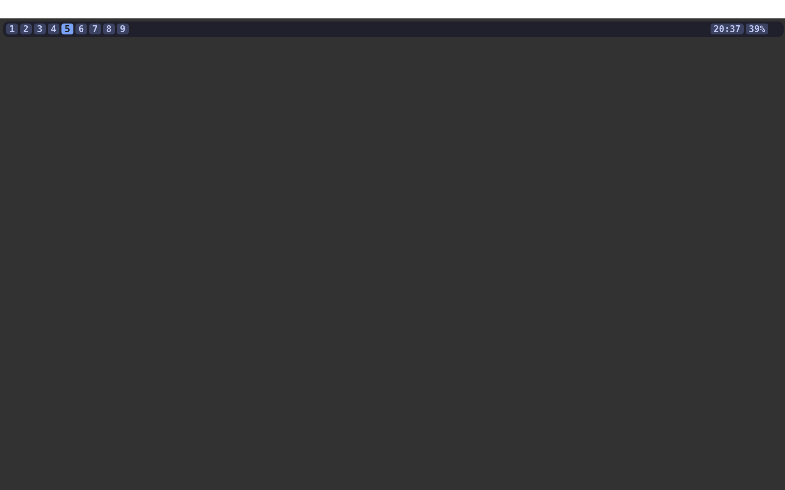

<div align="center">
  

  <h1>acwm</h1>

  <p><b>A</b> fast, practical Wayland compositor with a built-in status bar,
  native secrets and its own greeter — being ported to <b>Zig</b>.</p>

  <p><code>v0.1.0</code> · GPL-3.0 · Linux / wlroots 0.20</p>
</div>

---

acwm is a wlroots-based Wayland compositor in the dwl tradition: small, fast
to build, tags instead of workspaces — extended into something usable
day-to-day without the bloat. It ships as one package with the tools a real
session needs: an IPC client, a notification daemon, an app launcher, a
screenshot portal backend, a greetd greeter, and a secrets stack.

## Highlights

- **Built-in status bar** — rendered in-process as scene nodes: tag buttons,
  clock, battery, and an SNI system tray over sd-bus. No external bar needed.
  (`bar_enable=1`)
- **Tags, not workspaces** — each tag keeps its own independent layout
- **Smooth animations** — window open/move/close, tag transitions, layer
  surfaces (via scenefx)
- **Flexible layouts** — scroller, master-stack, monocle, dwindle, grid and
  more; per-client size weights with frame-accurate drag refreshing
- **Rich window states** — swallow, minimize, maximize, global, overlay,
  fakefullscreen
- **Built-in idle handling** — `idle_after` / `idle_command` /
  `resume_command`, hot-reloadable, honors session lock and idle inhibit
- **Native screenshot portal** — `acwm-portal` answers
  `org.freedesktop.impl.portal.Screenshot` directly; no external portal
  backend needed
- **Secrets built in** — pinned [oo7](https://github.com/linux-credentials/oo7)
  integration: keyring daemon, secret portal, login unlock via PAM
- **Own greeter** — `acwm-greeter` + greetd: acwm is its own login
  compositor, no SDDM required
- **Excellent xwayland support** — X11 apps without friction (no blurry
  scaling)
- **Sway-like scratchpad, hycov-style overview, text-input v2/v3**
- **IPC** — query and drive the compositor from scripts
- **Hot-reload config** — keybind and option changes without restart
- **Zero flickering** — every frame is correct

## Components

| Binary | Role |
|---|---|
| `acwm` | the compositor |
| `acwm-msg` | IPC client (query state, send commands) |
| `acwm-nag` | layer-shell notification client |
| `acwm-launch` | app launcher (`.desktop`, Flatpak, AppImage, running windows) |
| `acwm-portal` | screenshot portal backend |
| `acwm-greeter` | greetd greeter client |
| `oo7-daemon` / `oo7-portal` / `oo7-cli` | Secret Service provider (shipped pinned) |

## Install

### Nix / NixOS

```bash
# package
nix build github:iresolvedllc/acwm

# NixOS module (compositor + portals + oo7 + greeter wiring)
# flake.nix:
#   inputs.acwm.url = "github:iresolvedllc/acwm";
# configuration.nix:
{
  imports = [ inputs.acwm.nixosModules.acwm ];
  programs.acwm = {
    enable = true;
    oo7.enable = true;          # keyring + PAM unlock
    greeter.enable = true;      # greetd + acwm-greeter
  };
}
```

Home Manager options are also exposed (`hmModules.acwm`).

### Other distributions

acwm is not packaged by distributions yet. Build from source:

```bash
git clone https://github.com/iresolvedllc/acwm.git
cd acwm

# Zig build (Zig 0.17):
zig build --prefix=/usr

# or the meson build:
meson setup build && ninja -C build && sudo ninja -C build install
```

Dependencies: `wayland`, `wayland-protocols`, `wlroots 0.20`, `scenefx 0.5`,
`libinput`, `libxkbcommon`, `pixman`, `pcre2`, `pango`/`cairo`, `cjson`,
`libdisplay-info`, `hwdata`, `seatd`, and `libsystemd` (bar tray + portal
backend). Zig 0.17 for the Zig build; meson ≥ 1.x for the meson build.

Then copy the default config:

```bash
cp /etc/acwm/config.conf ~/.config/acwm/config.conf
```

## Documentation

Full documentation lives in [`docs/`](docs/) — configuration reference
(`docs/configuration/`), keybinds and gestures, portal and secrets setup
([oo7](docs/configuration/secrets.md)), the
[greetd greeter](docs/configuration/greetd.md), Nix module options
(`docs/nix-options.md`).

## Status: the Zig port

acwm is mid-port from C to Zig ([ROADMAP.md](ROADMAP.md) tracks the plan).
The compositor and all clients currently build as C under both `zig build`
and meson; modules are ported to Zig one at a time behind stable C-ABI
boundaries, each with unit tests:

```bash
zig build test   # runs the ported modules' test suites
```

Ported so far: the config value parser and the variable expander. The build
system, protocol codegen and packaging are already Zig-native.

## License

GPL-3.0. acwm is a derivative work of the
[mangowc](https://github.com/mangowm/mango) compositor by DreamMaoMao —
see [`UPSTREAM.md`](UPSTREAM.md) for the full lineage record, and the
acknowledgements below for everything acwm builds on.

## Acknowledgements

- [wlroots](https://gitlab.freedesktop.org/wlroots/wlroots) — Wayland protocol implementation
- [dwl](https://codeberg.org/dwl/dwl) — the foundation lineage
- [scenefx](https://github.com/wlrfx/scenefx) — window effects
- [sway](https://github.com/swaywm/sway) — protocol reference
- [greetd](https://sr.ht/~kennylevinsen/greetd/) — login manager daemon
- [oo7](https://github.com/linux-credentials/oo7) — Secret Service provider
- [zig-wlroots](https://codeberg.org/ifreund/zig-wlroots) / river — the Zig compositor pathfinders
